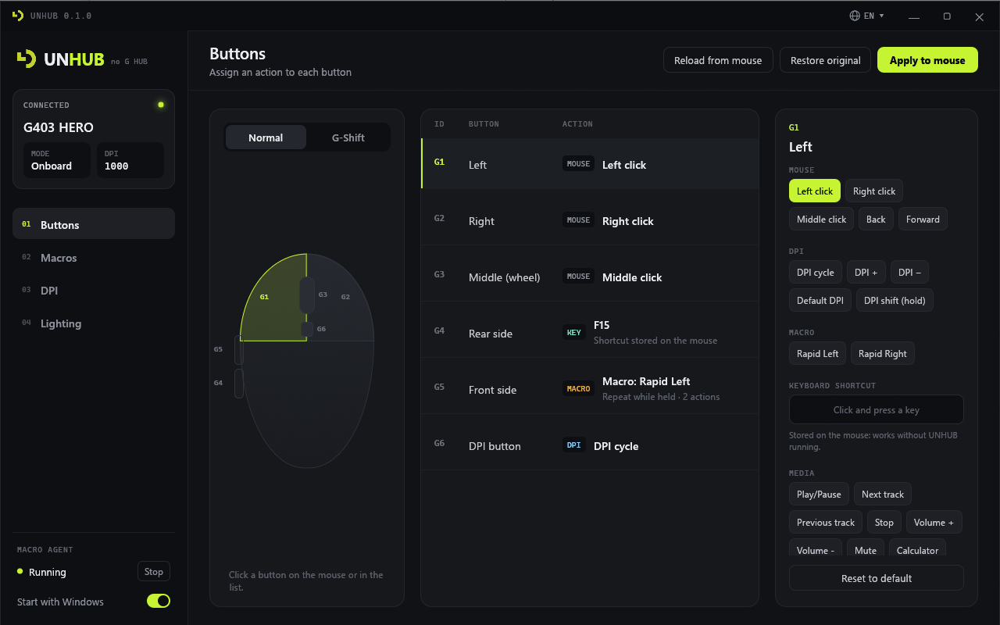
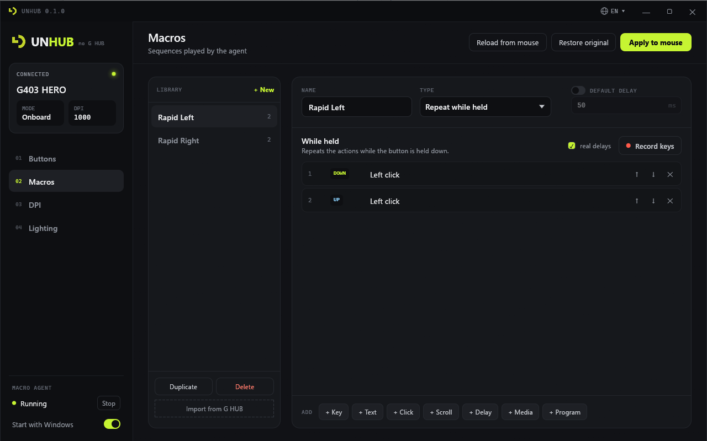
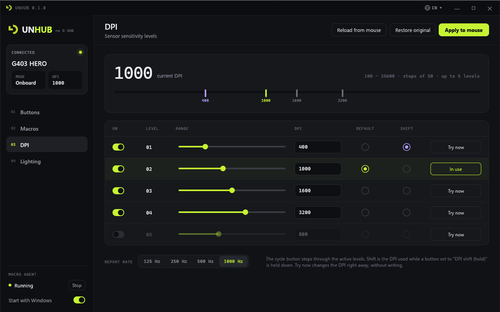
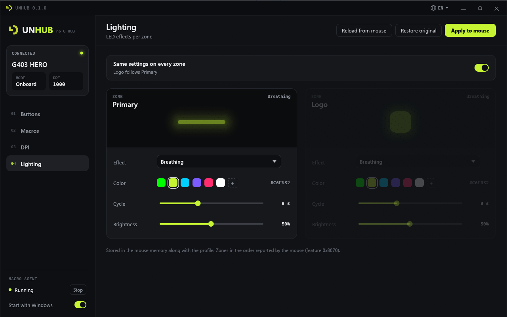
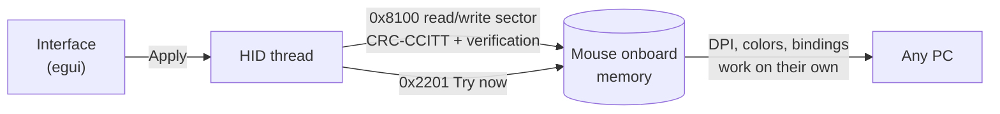
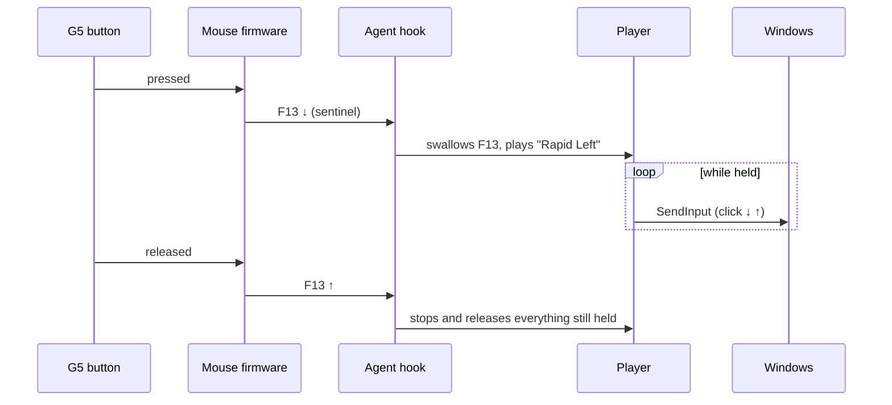

<p align="center">
  
</p>

<h1 align="center">UNHUB</h1>

<p align="center">
  <strong>Set up your Logitech G mouse without G HUB — written in Rust 🦀</strong><br>
  Buttons, DPI, lighting and macros, in a 17 MB executable that doesn't sit there running for nothing.
</p>

<p align="center">
  
  
  
  
  
</p>

<p align="center">
  <a href="#-features">Features</a> ·
  <a href="#-how-it-works">How it works</a> ·
  <a href="#-macros">Macros</a> ·
  <a href="#-getting-started">Getting started</a> ·
  <a href="#-translations">Translations</a> ·
  <a href="#-inside-the-protocol">Protocol</a> ·
  <a href="#%EF%B8%8F-project-layout">Project layout</a>
</p>

<p align="center">
  
</p>

---

**G HUB** is an Electron app plus an agent that stay open all the time, put the mouse in
"host mode" and control everything from software. **UNHUB** does the opposite: it writes the
settings **straight into the mouse memory** (the onboard profile) and gets out of the way. DPI,
colors and button bindings keep working with the program closed, on any PC. Only macros need
software, and for those there is a tiny agent in the system tray.

It is the Rust version of LGLITE (Python), with an interface designed in **Claude Design** and a
protocol worked out by reverse engineering G HUB itself.

## ✨ Features

| | Feature | Runs on | Needs UNHUB open? |
|---|---|---|---|
| 🖱️ | **Buttons** — mouse buttons, DPI, key + Ctrl/Shift/Alt/Win, media, G-Shift, disable | mouse memory | no |
| 🎯 | **DPI** — up to 5 levels, default, shift, report rate, *Try now* | mouse memory | no |
| 💡 | **Lighting** — off, solid, breathing, color cycle, per zone | mouse memory | no |
| ⚡ | **Macros** — G HUB's 4 macro types, key recording, import from G HUB | tray agent | only the agent |

- **G-Shift layer.** Every button gets a second action, active while the G-Shift button is held.
- **Clickable mouse drawing.** Click a button on the G403 to edit it, just like in G HUB.
- **Keyboard shortcuts stored on the mouse.** F13–F24, ABNT2 keys and PrintScreen included.
- **Automatic backup.** The original profile is saved before the first write; *Restore original* brings it back.
- **Warns you when G HUB is running**, since it overrides the onboard profile.
- **Single window.** Opening it again brings the existing window to the front.
- **Speaks your language.** Portuguese and English built in, switched on the fly from the title bar;
  more languages are just an XML file, no recompiling (see [Translations](#-translations)).
- **Lightweight.** One native `.exe`, no runtime, no background service.

<p align="center">
  
  
</p>
<p align="center">
  
</p>

## 🔧 How it works

G HUB has two parts: the Electron interface (`resources/app.asar`) and `lghub_agent.exe`, which
talks to the mouse over **HID++ 2.0**. UNHUB speaks HID++ directly to the mouse, through the
vendor interface `usage page 0xFF00 / usage 2` (long report `0x11`, device index `0xFF`).



Every write is **read back byte by byte** before the profile counts as written, and the CRC is
checked before sending. If anything doesn't match, nothing is activated.

## ⚡ Macros

The mouse can't store macros, so the trick is to keep it in onboard mode and use a **sentinel
key**: the button with a macro gets, in the mouse memory, a key between **F13 and F24**, which no
regular keyboard has. The agent catches that key, swallows it and plays the macro.



| Type | Behavior |
|---|---|
| **Run once** | plays the actions once on press |
| **Repeat while held** | repeats while the button is held down |
| **Toggle (on/off)** | one press starts repeating, the next one stops |
| **Press and release** | separate lists for press, hold (looped) and release |

- **Actions:** keys, text (Unicode, accents and emoji included), clicks, scrolling, delays, media and launching programs.
- **Key recording**, with or without the real delays between keys.
- **Default delay** between actions, like G HUB's `useDefaultDelay`.
- **Import from G HUB:** reads the macros you created in G HUB's `settings.db`, without changing anything there.
- **Keyboard by scan code**, which games using DirectInput and raw input understand.
- **Never leaves Ctrl "stuck":** when a macro ends or is interrupted, it releases everything it pressed.
- The agent **reloads the settings on its own** when the interface saves them. Limit: 12 buttons with macros.

> [!NOTE]
> Windows running as administrator only receive macros if the agent also runs as
> administrator. That's a Windows rule, and it applies to G HUB as well.

## 🚀 Getting started

You need [Rust](https://rustup.rs) (stable) and, on Windows, the Windows SDK's `rc.exe`
(installed with Visual Studio Build Tools), used to embed the icon in the executable.

```bash
cargo build --release
```

The executable ends up in `target/release/unhub.exe`. Copy it wherever you like.

> [!IMPORTANT]
> **Close G HUB** (tray icon included) before applying. It puts the mouse in host mode and
> ignores the onboard profile. UNHUB warns you when it's running.

| Command | What it does |
|---|---|
| `unhub.exe` | opens the interface |
| `unhub.exe --agent` | starts the macro agent (the sidebar's *Start* button does the same) |
| `unhub.exe --status` | prints the mouse state in the terminal, without writing anything |

*Start with Windows* registers the agent under `HKCU\...\Run` (no administrator rights needed).

### 📁 Where the data lives

| Path | Contents |
|---|---|
| `%APPDATA%\UNHUB\config.json` | macro library, which buttons use each macro, and the chosen language |
| `%APPDATA%\UNHUB\backups\` | original profile sector, saved before the first write |

Coming from **LGLITE**? On first run UNHUB copies `%APPDATA%\LGLITE` over: your macros and the
original backup keep working, and `config.json` has the same format. Just don't leave both agents
running together, since both capture F13–F24 (the interface warns you).

## 🌍 Translations

Every text UNHUB shows (window, notices, errors, tray menu and the `--status` output) comes from
[`locales/`](locales): **Português (Brasil)** and **English** ship inside the executable. Pick a
language from the 🌐 picker in the title bar, or leave it on *Automatic* to follow Windows. The
change applies at once, and the tray agent follows along.

Adding a language takes no compiler:

1. Copy [`locales/en.xml`](locales/en.xml) and change `code` and `name`:
   ```xml
   <language code="es" name="Español">
     <string key="nav.buttons">Botones</string>
     <plural key="macro.count"><one>{n} acción</one><other>{n} acciones</other></plural>
   </language>
   ```
2. Translate the text between the tags. Keep each `key` and every `{placeholder}`; `<plural>`
   takes `<one>` (for 1) and `<other>`.
3. Save it as `es.xml` in `%APPDATA%\UNHUB\locales\` (or in a `locales` folder next to
   `unhub.exe`) and reopen UNHUB. It shows up in the language picker.

Missing keys fall back to English, then Portuguese, so a partial translation still works. A file
with the code of a built-in language overrides just the keys it has. To ship a language inside the
executable, add the file to `locales/` and to `BUILT_IN` in [`src/i18n.rs`](src/i18n.rs);
`cargo test` then checks that it has every key the code uses.

## 🔬 Inside the protocol

| Feature | Used for |
|---|---|
| `0x0000` / `0x0001` | feature index (the G403 answers HID++ 4.2, 17 features) |
| `0x2201` Adjustable DPI | sensor range (100–25,600, step 50) and *Try now* |
| `0x8100` Onboard Profiles | reading and writing the profile, onboard mode |
| `0x8070` Color LED Effects | available zones and effects (0x00, 0x01, 0x03, 0x0A) |

Profile sector (256 bytes, big-endian CRC-CCITT at the end), validated against the real mouse:

```text
0        rate (1000/Hz)      1  default DPI index      2  DPI shift index
3..12    5 × DPI uint16 LE
32..95   16 buttons × 4 bytes       96..159  16 G-Shift buttons
208/219  light effect zone 0 (logo) / zone 1 (primary), 11 bytes; copy at 230/241
254..255 CRC
```

| Bytes | Meaning |
|---|---|
| `80 01 MM MM` | mouse button (bitmask) |
| `80 02 MOD KEY` | HID key + modifiers |
| `80 03 UU UU` | media (Consumer usage) |
| `90 NN ff ff` | firmware function (`05` = DPI cycle, `0B` = G-Shift…) |
| `ff ff ff ff` | disabled |
| `01 RR GG BB` | solid light |
| `03 … PP PP II` | color cycle, period in ms |
| `0A RR GG BB PP PP WF II` | breathing |

Unknown formats are **kept intact**: UNHUB only rewrites the bytes you changed.

## 🗂️ Project layout

```text
UNHUB/
├── src/
│   ├── main.rs        entry point: interface, --agent, --status, single instance
│   ├── hidpp.rs       HID++ 2.0 transport and feature 0x2201 (DPI)
│   ├── onboard.rs     feature 0x8100: profile sector, buttons, LEDs, CRC
│   ├── mouse.rs       mouse session and backup of the original
│   ├── device.rs      HID thread (the interface never freezes waiting on the mouse)
│   ├── macros.rs      macro model and G HUB import
│   ├── config.rs      config.json and the F13–F24 sentinel keys
│   ├── player.rs      macro player (all 4 types)
│   ├── winput.rs      SendInput and keyboard hook
│   ├── agent.rs       tray agent, start with Windows
│   ├── capture.rs     shortcut capture and key recording
│   ├── i18n.rs        translations loaded from locales/*.xml
│   └── ui/            egui interface: theme, pages, dialogs, mouse drawing
├── locales/           pt-BR.xml and en.xml: every text the program shows
├── assets/logo.svg    logo (also the .exe, window and tray icon)
├── docs/images/       screenshots
├── tests/fixtures/    sectors read from a real G403 HERO
└── build.rs           turns logo.svg into the Windows icon
```

```bash
cargo test
```

The tests use sectors read from a **real G403 HERO**: the profile must round-trip byte for byte,
and an edit may only touch the bytes it is supposed to. They also check that both languages have
exactly the keys the code uses.

Want a different icon? Replace `assets/logo.svg` and run `cargo build --release`.

## 🙏 Credits

- Interface designed in **Claude Design**; built with [egui/eframe](https://github.com/emilk/egui).
- Also uses [hidapi](https://github.com/ruabmbua/hidapi-rs), [tray-icon](https://github.com/tauri-apps/tray-icon),
  [resvg](https://github.com/linebender/resvg), [rusqlite](https://github.com/rusqlite/rusqlite) and
  [roxmltree](https://github.com/RazrFalcon/roxmltree).
- Logitech, Logitech G and G HUB are trademarks of Logitech. UNHUB is an independent project, not
  affiliated with Logitech. No G HUB code is included.

<p align="center"><sub>Made with 🦀 and a G403 that just wanted some peace.</sub></p>
